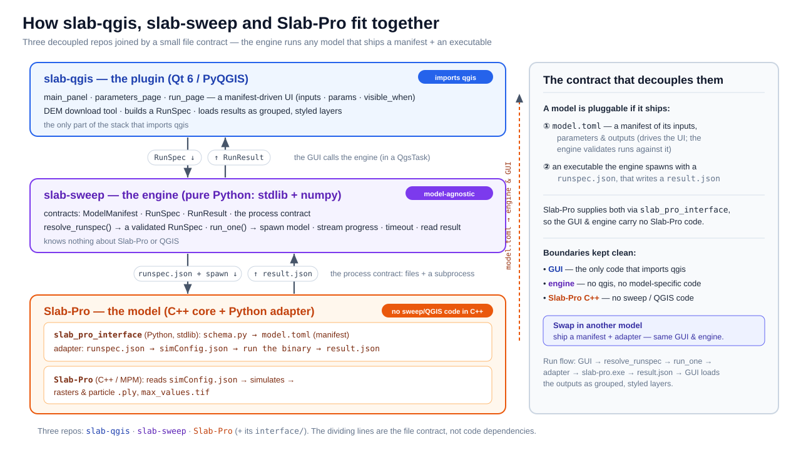

# ALMO Sweep — QGIS plugin

A QGIS 4 / Qt 6 front-end for the [almo-sweep](../almo-sweep) simulation engine. Load a DEM
and release-zone layers, build a model's parameters from its manifest, run mass-movement
simulations, and load the results back onto the map — all from the QGIS canvas.

The plugin is **model-agnostic**: it drives any model that ships an ALMO *manifest*
(`model.toml`). This guide uses the [dampm](../dampm) model as the example.

## How the stack fits together



Three repos, decoupled by a small **file contract** rather than code dependencies: this
**plugin** (the only part that imports `qgis`) drives the **[almo-sweep](../almo-sweep)** engine
(pure Python, model-agnostic), which runs any **model** that ships a `model.toml` manifest plus an
executable entry point. [dampm](../dampm) provides both via its `dampm_interface/` adapter, so the
GUI and the engine contain no dampm-specific code.

---

## Requirements

- **QGIS 4.x / Qt 6** (developed against QGIS 4.2.2; also runs on the QGIS 3.44 Qt 6 build).
- The **almo-sweep** engine (pure Python, stdlib + numpy).
- A **model** to run: its ALMO adapter (e.g. `dampm_interface`) plus its built binary. See
  the model's own README (e.g. [dampm](../dampm/README.md)) for building the binary.

The engine and the model adapter are Python packages that must be installed **into QGIS's own
Python interpreter** (not a system/conda Python). The steps below do this in order.

---

## Install

Follow these steps top to bottom.

### 1. Locate QGIS's Python interpreter

Open **QGIS ▸ Plugins ▸ Python Console** and run:

```python
import sys; print(sys.executable)
```

You'll use this interpreter for the `pip` steps below. Typical locations (yours may differ):

| OS | QGIS Python for `pip` |
|----|-----------------------|
| **Windows** | `C:\Program Files\QGIS 4.2.2\bin\python-qgis.bat` |
| **macOS**   | `/Applications/QGIS-<version>.app/Contents/MacOS/python` |
| **Linux**   | the system `python3` QGIS was built against (often just `python3`) |

Below, `<qgis-python>` means that interpreter.

### 2. Install the engine into QGIS's Python

```bash
<qgis-python> -m pip install -e /path/to/ALMO/Simulations/almo-sweep
```

### 3. Install the model adapter into QGIS's Python

For dampm:

```bash
<qgis-python> -m pip install -e /path/to/ALMO/Simulations/dampm/interface
```

You also need dampm's compiled binary — build it per [dampm/README.md](../dampm/README.md).
You will point the plugin at that binary in step 7 (no environment variables needed).

> **macOS note:** if pip can't write into the app bundle, prefix the command with `sudo`.

### 4. Link the plugin into your QGIS profile

Find your profile's plugin folder via **QGIS ▸ Settings ▸ User Profiles ▸ Open Active Profile
Folder**, then go into `python/plugins/`. Typical defaults:

| OS | Plugins folder |
|----|----------------|
| **Windows** | `%APPDATA%\QGIS\QGIS4\profiles\default\python\plugins` |
| **macOS**   | `~/Library/Application Support/QGIS/QGIS4/profiles/default/python/plugins` |
| **Linux**   | `~/.local/share/QGIS/QGIS4/profiles/default/python/plugins` |

Link the `almo_sweep_qgis/` folder into it (a link means code changes are picked up on
reload — no re-copying):

**Windows** (PowerShell; junctions need no admin rights):
```powershell
$plugins = "$env:APPDATA\QGIS\QGIS4\profiles\default\python\plugins"
New-Item -ItemType Directory -Force -Path $plugins | Out-Null
New-Item -ItemType Junction -Path "$plugins\almo_sweep_qgis" `
         -Target "C:\path\to\ALMO\Simulations\QGIS_Simulation_GUI\almo_sweep_qgis"
```

**macOS / Linux**:
```bash
plugins="$HOME/Library/Application Support/QGIS/QGIS4/profiles/default/python/plugins"  # macOS
# plugins="$HOME/.local/share/QGIS/QGIS4/profiles/default/python/plugins"               # Linux
mkdir -p "$plugins"
ln -s /path/to/ALMO/Simulations/QGIS_Simulation_GUI/almo_sweep_qgis "$plugins/almo_sweep_qgis"
```

*(If you can't create a link, copying the `almo_sweep_qgis/` folder in also works; you'll
re-copy after each code change.)*

### 5. Enable the plugin

Restart QGIS. Open **Plugins ▸ Manage and Install Plugins**, tick **Show also experimental
plugins** under *Settings*, then enable **ALMO Sweep** under *Installed*. A green-slope
toolbar button appears; click it to show the **ALMO Sweep** dock panel.

---

## Use

### Download a DEM for a region (optional)

If you don't already have a DEM, the panel header has **Download DEM for region…**. Pick a
provider (currently **swissALTI3D** from swisstopo, 0.5 m or 2 m source tiles), a **polygon layer**
outlining your region of interest, and an output file; the covering tiles are fetched and **merged
into one clipped GeoTIFF** (in the background), then added to the map **as a hillshade** ready to
use as the DEM input. You can optionally **resample** the output to a different resolution with a
chosen method (bilinear — a 2×2 kernel — by default; "average" is better for downsampling). Tiles
are listed live from the provider's STAC API, so the current data is always used. Adding another
provider is a single class in `almo_sweep_qgis/dem/providers.py` — it then appears in the dropdown
automatically. (The region polygon layer must be in a CRS with an EPSG code, e.g. EPSG:2056.)

### 6. Register and select a model

The panel header holds a **persistent list of models**. The first time, click **Add…** and
select the model's manifest, e.g. `dampm/interface/model.toml` — it's added to the list and
selected. On later launches it's already there: just pick it from the dropdown. **Remove**
drops the selected entry. The list (and the last model you had open) survive QGIS restarts, and
each model remembers its own runtime settings (below), so a model you've used before is ready
to run with its binary/DLL paths already set. The status line confirms the model, its inputs
and parameters.

### 7. Configure the model's runtime settings (once per machine)

Click **Model settings…** (next to the model selector) and fill in the paths the model needs.
These are stored per model and reused every time you select it. For dampm:

- **`DAMPM_BIN`** — the compiled dampm executable (required).
- **`DAMPM_DLL_DIR`** — **Windows only**: the folder with dampm's runtime DLLs
  (e.g. `C:\msys64\ucrt64\bin` for an MSYS2 build). **Leave empty on macOS/Linux.**

These are stored in QGIS settings and remembered across sessions — no environment variables,
no launching QGIS from a terminal.

### 8. Parameters (inputs + settings) and run

1. **Parameters** — one page holds everything about the run: the spatial inputs *and* the
   model settings, laid out under their manifest **group** headings and labelled with human
   names. Controls that only apply in certain cases appear automatically when relevant — e.g.
   the Voellmy coefficients show only when the friction law is Voellmy, and (for dampm) the
   **release-zone layer appears only when the release shape is `POLYGON`**; `RECTANGLE` and
   `ELLIPSE` releases are defined numerically instead. For dampm the DEM must be an ESRI ASCII
   `.asc` and the release a polygon shapefile; load them into QGIS first.

   - **DEM resolution** — under each raster picker the selected raster's native **resolution** is
     shown. Tick **Resample to** to coarsen/refine it to a chosen cell size with a chosen method
     (bilinear — a 2×2 kernel — by default; "average" is better for downsampling) and click
     **Apply**. The result is written to a new GeoTIFF (defaulting to the source name plus
     `_<res>m`, e.g. `dem_05m.tif` for 0.5 m, in the source's folder — you can change the path),
     added as a hillshade, and selected as the input. Resampling is skipped if the target equals
     the current resolution.
   - **Release estimate** — in the release section, below the release selection, a live approximate
     **area** and **volume** for the current release is shown as you edit: the polygon's area for a
     `POLYGON` release, `Lx·Ly` / `π·rx·ry` for a `RECTANGLE` / `ELLIPSE`, and (for a `RASTER`
     release) the cell size × the released cells, with volume = area × depth (`h0`) or, for a
     raster, the summed per-cell depths × cell area. It refreshes automatically when you edit the
     release polygon and commit/save it.
2. **Run** — set a run name and output folder, choose which outputs to keep, and click **Run**.
   Progress shows in the panel and in QGIS's task bar. If any chosen input layer isn't saved to
   disk yet (a scratch/temporary or project-embedded layer), you're asked where to save it first,
   since the model reads inputs from files. Each run's `runspec.json`, `simConfig.json` and
   `result.json` are written into the output folder for provenance. **Stop** cancels every running
   simulation — it terminates the model process itself (not just the task wrapper), so a run stops
   immediately rather than finishing in the background.

   On success, **all of a run's outputs are added under one layer group named after the run**:
   - **Multi-band rasters** (`final_grid`, `max_values`) are **unpacked into one single-band layer
     per band**, each in its own subgroup, rendered **single-band pseudocolor (Turbo)**.
   - A **series of raster frames** (`grid_series`) is loaded as **temporal groups** — one per band
     (**flow height**, **velocity**). Each frame is a timestamp (spaced by the model's output
     interval); the colour upper bound per band comes from `max_values.tif` (the run maxima), so
     colours are consistent across frames. Open **View ▸ Panels ▸ Temporal Controller** in
     animation mode to step/play through them.

---

## Development

### Layout

```
almo_sweep_qgis/            the plugin package (this folder is what QGIS loads)
  __init__.py               classFactory entry point
  metadata.txt              QGIS plugin metadata
  plugin.py                 AlmoSweepPlugin: menu/toolbar + dock lifecycle
  settings.py               per-model runtime settings (QgsSettings)
  panels/                   main_panel, parameters_page (inputs + params), run_page,
                            run_task, settings_dialog
  resources/icon.svg        toolbar icon
tests/                      headless tests (run under QGIS's Python)
```

The plugin is the only part of the stack that imports `qgis`; all model-agnostic logic lives
in the `almo-sweep` engine.

### Tests

The tests import `qgis`, so they run under QGIS's Python (install `pytest` there once):

```bash
<qgis-python> -m pip install pytest
<qgis-python> -m pytest
```

### Static checks

Linting/formatting need no QGIS and run via pre-commit:

```bash
pre-commit run --all-files
```

Type-checking runs under QGIS's Python (`qgis` ships only partial stubs), so it is not wired
into pre-commit; the engine core, by contrast, is fully `mypy --strict`.
