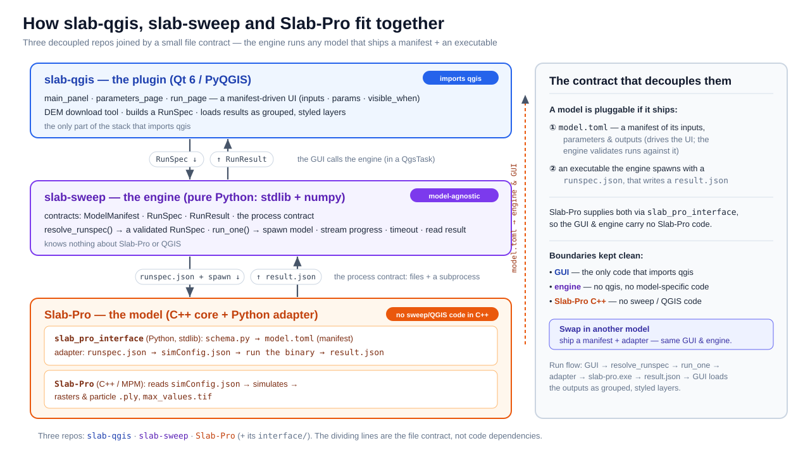

# Developing Slab-QGIS

Setting up the plugin from source, the code layout, tests and the plugin zip. Branches, pull
requests and commit style are in [CONTRIBUTING.md](../CONTRIBUTING.md); publishing a release is in
[RELEASING.md](../RELEASING.md).

## The stack



Three repositories, decoupled by a small **file contract** rather than code dependencies: this
**plugin** (the only part that imports `qgis`) drives the
**[slab-sweep](https://github.com/ALMO-SLF-ETH/slab-sweep)** engine (pure Python,
model-agnostic), which runs any **model** that ships a `model.toml` manifest plus an executable
entry point. [Slab-Pro](https://github.com/ALMO-SLF-ETH/Slab-Pro) provides both through its
`slab_pro_interface/` adapter, so the plugin and the engine contain no Slab-Pro-specific code.
The manifest format is specified in slab-sweep's
[docs/manifest-spec.md](https://github.com/ALMO-SLF-ETH/slab-sweep/blob/main/docs/manifest-spec.md).

## Set up from source

Clone this repository and [slab-sweep](https://github.com/ALMO-SLF-ETH/slab-sweep) side by side
(the tests find a sibling `slab-sweep` checkout); for running Slab-Pro from source, also clone
[Slab-Pro](https://github.com/ALMO-SLF-ETH/Slab-Pro) and build it per its README.

### 1. Locate QGIS's Python interpreter

The engine and model adapters must be installed **into QGIS's own Python** (not a system or conda
Python). Open **QGIS ▸ Plugins ▸ Python Console** and run:

```python
import sys; print(sys.executable)
```

Typical locations (yours may differ):

| OS | QGIS Python for `pip` |
|----|-----------------------|
| **Windows** | `C:\Program Files\QGIS 4.2.2\bin\python-qgis.bat` |
| **macOS**   | `/Applications/QGIS-<version>.app/Contents/MacOS/python` |
| **Linux**   | the system `python3` QGIS was built against (often just `python3`) |

Below, `<qgis-python>` means that interpreter.

### 2. Install the engine (and a model adapter) editable

```bash
<qgis-python> -m pip install -e /path/to/slab-sweep
<qgis-python> -m pip install -e /path/to/Slab-Pro/interface   # optional: Slab-Pro from source
```

An importable slab-sweep takes precedence over the copy bundled in a plugin zip, so engine changes
are picked up at once. On macOS, prefix with `sudo` if pip cannot write into the app bundle.

### 3. Link the plugin into your QGIS profile

Find your profile's plugin folder via **QGIS ▸ Settings ▸ User Profiles ▸ Open Active Profile
Folder**, then `python/plugins/`. Typical defaults:

| OS | Plugins folder |
|----|----------------|
| **Windows** | `%APPDATA%\QGIS\QGIS4\profiles\default\python\plugins` |
| **macOS**   | `~/Library/Application Support/QGIS/QGIS4/profiles/default/python/plugins` |
| **Linux**   | `~/.local/share/QGIS/QGIS4/profiles/default/python/plugins` |

Link the `slab_qgis/` folder into it, so code changes are picked up on reload:

**Windows** (PowerShell; junctions need no admin rights):
```powershell
$plugins = "$env:APPDATA\QGIS\QGIS4\profiles\default\python\plugins"
New-Item -ItemType Directory -Force -Path $plugins | Out-Null
New-Item -ItemType Junction -Path "$plugins\slab_qgis" -Target "C:\path\to\slab-qgis\slab_qgis"
```

**macOS / Linux**:
```bash
plugins="$HOME/Library/Application Support/QGIS/QGIS4/profiles/default/python/plugins"  # macOS
# plugins="$HOME/.local/share/QGIS/QGIS4/profiles/default/python/plugins"               # Linux
mkdir -p "$plugins"
ln -s /path/to/slab-qgis/slab_qgis "$plugins/slab_qgis"
```

Restart QGIS and enable **Slab-QGIS** in **Plugins ▸ Manage and Install Plugins ▸ Installed**
(tick *Show also experimental plugins* under *Settings*). Register a source model with **Add…**
(e.g. `Slab-Pro/interface/model.toml`) and set its paths in **Model settings…**.

## Layout

```
slab_qgis/                  the plugin package (this folder is what QGIS loads)
  __init__.py               classFactory entry point
  metadata.txt              QGIS plugin metadata (name, version, QGIS versions, links)
  plugin.py                 SlabQgisPlugin: toolbar/menu action, dock lifecycle, update check
  engine.py                 the slab-sweep engine: installed, or bundled in _vendor/
  settings.py               per-model runtime settings and the model list (QgsSettings)
  state.py                  shared StudyState (manifest, inputs, params, sweep config)
  sweep_plan.py             plain-data sweep config -> engine distributions + strategy; run count
  catalog/                  published models: registry, GitHub releases, safe installs, updates
  dem/                      DEM download providers (swissALTI3D)
  panels/                   main_panel (tabbed), parameters_page, run_page, run_pipeline,
                            run_task, results_page, preprocessing_page, settings_dialog,
                            models_dialog ("Get models…"), intro (the intro animation)
  results/                  study.py (read runs.json/study.json), aggregate.py (hazard maps)
  resources/                icon.svg, intro.gif, models.json (the models the plugin offers)
engine.toml                 the slab-sweep release a plugin zip bundles
scripts/                    build_plugin.py, smoke_zip.py, bump_engine.py, intro_animation/
tests/                      headless tests (run under QGIS's Python)
```

The plugin is the only part of the stack that imports `qgis`; all model-agnostic logic lives
in the slab-sweep engine.

## Tests

The tests import `qgis`, so they run under QGIS's Python (install `pytest` there once):

```bash
<qgis-python> -m pip install pytest
<qgis-python> -m pytest
```

Without a display (CI, a remote shell), set `QT_QPA_PLATFORM=offscreen`. CI runs the suite in the
`qgis/qgis:ltr` and `qgis/qgis:stable` images.

## Static checks

Linting and formatting need no QGIS and run through pre-commit:

```bash
pre-commit run --all-files
```

Type-checking runs under QGIS's Python (`qgis` ships only partial stubs), so it is not wired
into pre-commit; the engine core, by contrast, is fully `mypy --strict`.

## The plugin zip

The installable zip bundles the slab-sweep release pinned in [`engine.toml`](../engine.toml)
under `slab_qgis/_vendor/`, so users need not install the engine themselves. The plugin uses the
bundled copy only when no slab-sweep is importable.

```bash
python scripts/build_plugin.py                         # engine pinned in engine.toml
python scripts/build_plugin.py --engine-wheel <wheel>  # or a local slab-sweep wheel
<qgis-python> scripts/smoke_zip.py dist/slab_qgis-<version>.zip
```

The build script checks the zip (one `slab_qgis/` folder with `metadata.txt`, `LICENSE`, the engine
and its licence, no bytecode). The smoke test loads the bundled engine in QGIS's Python and runs a
model with it; run it where slab-sweep is not installed. CI does both on every push. When
slab-sweep publishes a release, a workflow opens a pull request that updates `engine.toml`; see
[RELEASING.md](../RELEASING.md).

## The model registry

`slab_qgis/resources/models.json` lists the models **Get models…** offers: an id, a name, the
GitHub repository whose releases are installed, and the release file for each platform
(`windows-x86_64`, `linux-x86_64`, `macos-arm64`, …; `{version}` is the release version). The
plugin refreshes it from the copy published with each plugin release
(`https://almo-slf-eth.github.io/slab-qgis/models.json`), so a new model can be offered by
publishing a plugin release. A model's release files must be archives (`.zip` or `.tar.gz`) with a
`model.toml` at the top or in a single top-level folder, and the release must list SHA-256 digests
(GitHub does this for every uploaded file).

## The intro animation

`slab_qgis/resources/intro.gif` is built by the scripts in
[`scripts/intro_animation/`](../scripts/intro_animation/README.md): the text becomes a Slab-Pro
release on a slope, Slab-Pro simulates the collapse, and the particle snapshots are rendered
backwards into the GIF.
